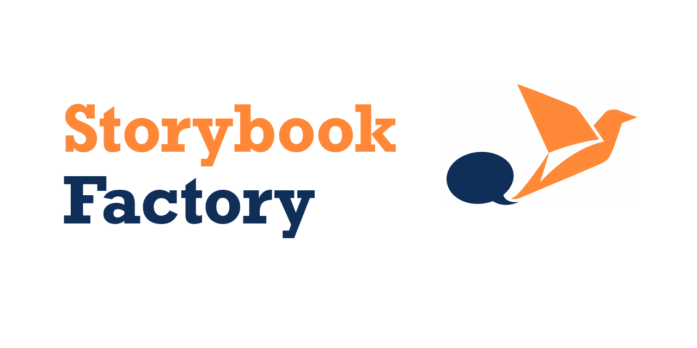

# Storybook Factory



Storybook Factory is a Python toolkit for turning English transcripts into illustrated French CE1 storybooks. It tracks source and adaptation reviews, recurring characters and sets, illustration attempts, and reading and print PDFs.

## Run the offline example

Install Python 3.11 or later and [uv](https://docs.astral.sh/uv/), then run:

```sh
git clone https://github.com/hershalpandya/storybookfactory.git
cd storybookfactory
uv sync --locked
uv run --locked storybook --help
```

Follow [Pip and the Kite](examples/pip-and-the-kite/README.md) to build a four-page reading preview from the sample transcript and review files. After dependency setup, the example runs offline and uses placeholder artwork.

## Start a story

Keep each story under `projects/`. Put agent reports, working documents and handoffs under `reports/`, such as `reports/my-story/`. Git ignores both directories. Create a workspace from the repository root:

```sh
uv run --locked storybook init projects/my-story --workspace
```

Choose a workspace path that does not exist yet. Open the generated `projects/my-story/README.md` for the file map. Reuse the same directory when resuming work.

| Location | What goes there |
| --- | --- |
| `projects/my-story/inputs/` | English UTF-8 transcripts, review drafts, edition plan and book metadata |
| `projects/my-story/source-review/` | The source project initialized by `--workspace`, with registered transcripts, approved text and catalogs |
| `projects/my-story/book-edition/` | The edition created by `storybook edition import`, with art, revision history and generation journals |
| `projects/my-story/outputs/previews/` and `projects/my-story/outputs/final/` | Dated build folders containing PDFs, reviewed text and the proof report |

Open this checkout in a coding agent and give it a starting instruction:

> Follow `.agents/skills/storybook/SKILL.md` to make a French CE1 storybook from `projects/my-story/inputs/transcript.txt`. Use the project layout in the README. Ask for source and adaptation review and confirm the image provider and budget before requesting art.

For recurring settings, render and stage each page's camera view locally with `edition set-layout --stage` before submitting scene art. The [offline example](examples/pip-and-the-kite/README.md) walks through this step. For exported agent instructions and guides, run `storybook export-workflow NEW_DIRECTORY` from a checkout or a synced, unpacked source archive.

Run `uv run --locked storybook edition build projects/my-story/book-edition --mode reading` for a preview. The command reports the new output path. Add `--final` after the artwork and layout approvals are current.

For a manual workflow, see [source preparation](docs/PROJECT-FORMAT.md), [French CE1 adaptation](docs/LANGUAGE-MODULES.md), [edition planning and commands](docs/EDITIONS.md), and [printing and proofing](docs/BOOK-RENDERING.md). The [provider guide](docs/PROVIDERS.md) covers the Gemini adapter and externally operated tools. Get the story owner's authorization before sharing private material with any provider.

## Contribute

Use the [contributor guide](CONTRIBUTING.md) for the code map, test commands and skill workflow. Agents start with [AGENTS.md](AGENTS.md). See [SECURITY.md](SECURITY.md) for private vulnerability reporting.

The toolkit uses the [MIT License](LICENSE). See the [third-party notices](THIRD-PARTY-NOTICES.md) for the bundled Marelle 2 font and vendored skills.

Maintained by Hershal Pandya. [Hershal Pandya on LinkedIn](https://www.linkedin.com/in/hershalpandya/)
